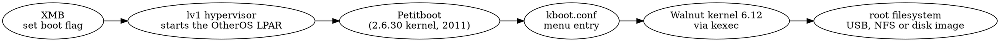

The PlayStation 3 still has Linux distributions: Gentoo, T2 SDE, and Debian's unofficial big-endian PowerPC port. I wanted something a bit different from any of them. I wanted the current long-term-support kernel, 6.12, with Debian's userland on top, and a GPU driver and a package repository of my own around it. A kernel other people still read and patch makes all of that easier. This article is about getting that kernel to boot, and the handful of things that went wrong in the first days.

## The pieces

A few terms first, because the console is not a PC.

**Cell, PPE and SPE.** The CPU is a Cell Broadband Engine. The PPE is its general-purpose core: 64-bit PowerPC, two hardware threads, big-endian. Linux runs on the PPE. The SPEs are small vector cores that run their own programs out of their own local memory. Linux gets six of them, and loads programs onto them through a filesystem called spufs.

**lv1.** The hypervisor. The PS3 never lets an operating system touch the hardware directly. Linux boots as a guest in a logical partition and asks lv1 for memory, interrupts, disks and the GPU with hypercalls. The platform code in the kernel (`arch/powerpc/platforms/ps3`, `drivers/ps3`) is a layer over those calls.

**OtherOS++.** Sony's own OtherOS feature could boot Linux, but as far as I have read it kept the guest away from the GPU. OtherOS++ is a set of patches from the homebrew scene (graf_chokolo's lv1 work, carried forward by glevand and later by the psx-place and Gentoo communities) that widens what a guest may do. On a console with custom firmware you install it from a plugin in the XMB menu. The plugin resizes the virtual flash regions on the internal disk and writes a bootloader into one of them.

**Petitboot.** That bootloader. It is a small Linux system of its own. When the boot flag is set to OtherOS, the console starts Petitboot instead of GameOS. Petitboot scans every disk, builds a menu from the `kboot.conf` files it finds, and loads your kernel with `kexec`.

The Petitboot image I use is a build of glevand's from June 2011: a 2.6.30.10 kernel, kexec-tools 2.0.2, BusyBox 1.17. I unpacked its initramfs on my PC and read it before relying on anything about it. The age of that image matters in a minute.

Petitboot reads `kboot.conf` as one entry per line, `label=image args`. It ignores `default` and `timeout`, so nothing boots on its own; whoever sits at the console picks. Every reboot from Linux ends in GameOS, never back in Petitboot. A session therefore goes: set the OtherOS flag in the XMB, restart, pick a kernel, work, and at the end set the flag back to GameOS.

## Why 6.12, and from whose source

6.12 is a long-term kernel, supported until December 2028. I build it from Debian trixie's `linux` source package (`6.12.111-1`) plus patches, cross-compiled for ppc64 into ordinary `.deb` files. Using Debian's source rather than a tarball means I inherit its packaging and its stable backports. The first commit of the project still used a kernel.org 6.12.112 tarball; I switched to Debian's source a few days later.

Debian has no stable release for big-endian 64-bit PowerPC, only the unofficial debian-ports archive, which follows unstable. I pin a snapshot of it and call the snapshot my release. It moves when I decide, not when Debian does.

On top of Debian's source sit two sets of patches. The first is the OtherOS++ set from the psx-place collection, which is glevand's work refreshed for 6.12. The second is 31 patch files of my own in `linux/patches/local/`. Most of mine are small. The rest of this article is about the first few.

## What I did not apply

Before I trusted the OtherOS++ set, I surveyed every PS3 kernel patch I could find outside my tree: glevand's, Geoff Levand's queue on kernel.org, T2 SDE, Gentoo, mainline after 6.12, and postings on linuxppc-dev. I sorted each patch by what it can touch:

- read-only, or a plain software fix: fine;
- changes hardware or hypervisor state at run time only (gone after a power cycle): careful;
- can write flash, EEPROM or the system controller (SYSCON): never.

Two kinds of finding came out of it. The first is good fixes that 6.12 lacked. Thirteen went in as `local/0020` to `0032`. Some were already in mainline after 6.12, like Florian Fuchs's gelic receive fixes (a skb allocation failure no longer oopses the poll function, and RX uses NAPI and GRO). Ten are spufs fixes that Junrui Luo and Zhenhao Wan posted in August 2026 and nobody has merged, since spufs has no maintainer. I read each against the 6.12 code before taking it. One of them claims that `simple_attr_open()` overwrites `private_data`, so a fault on a `cntl` mapping treated the wrong object as the SPU context. I checked that in my tree and it holds.

The second finding is that some patches in the OtherOS++ set reach further than I want. I dropped four, and turned one config option off:

- `ps3sysmgr-char-device` gave root a raw channel to the System Manager. Which of its services change persistent state is not documented, and while the device is open the kernel stops handling power-button and thermal events. Dropped.
- `ps3rom-vendor-specific-command` passed arbitrary SCSI commands through to the Blu-ray drive. Nothing in my tree used it. Dropped.
- `gelic-disable-eurus-ctrl-iface` wrote to the hypervisor's repository at every boot, which goes around the config option that turns repository writes off. It served only the internal Wi-Fi driver `ps3jupiter`, so both went. Wi-Fi now means the stock gelic wireless path, which I haven't tested.
- The dispatcher manager (`/dev/ps3dispmngr`) carries the update manager, which does firmware updates and EEPROM writes. Its config option is off.

`ps3lv1call` and `ps3physmem`, which let userspace make arbitrary hypercalls or map the partition's whole memory, exist as modules that nothing loads automatically.

## The first boot

I started with the console on the network. A Makefile builds the kernel in a pinned Debian container, and a netboot script pushes it into Petitboot's shell over telnet and kexecs it with an NFS root. That loop worked on the first day, 2026-10-14, once these things were sorted out.

### Petitboot cannot enter a modern big-endian kernel

Since 6.5, big-endian PowerPC kernels are built for the ELFv2 ABI by default. The kexec-tools in a 2011 Petitboot knows only ELFv1. The fix is a config choice:


# Petitboot's kexec-tools (2.0.2, 2011) predates big-endian ELFv2 kernels: build ELFv1
# (the default before 6.5). Turning it off needs EXPERT.
CONFIG_EXPERT=y
# CONFIG_PPC64_BIG_ENDIAN_ELF_ABI_V2 is not set


The commit message says "Petitboot's 2011 kexec can't enter BE ELFv2". Almost nobody builds big-endian ELFv1 kernels now, and that leads to the next problem.

### Processes died with SIGILL

With the ELFv1 kernel booting, every process that used glibc's vDSO `getrandom` hit an illegal instruction. glibc 2.41 and later call a function in the kernel's vDSO, the small shared object the kernel maps into every process, to get random bytes without a system call. On ELFv1, a C call goes through a "dot symbol" in front of the function. The kernel's assembly file defined the function (`__arch_chacha20_blocks_nostack`) but no dot symbol (`.__arch_chacha20_blocks_nostack`) for it. The vDSO linked the call to address 0, and the process ended up executing the vDSO's ELF header as code.

The fix is a few lines in `arch/powerpc/kernel/vdso/vgetrandom-chacha.S`, which define the missing symbol under `CONFIG_PPC64_ELF_ABI_V1`. It is `local/0001`.


Not checked: whether this has been fixed or reported upstream. The docs list it as a local patch only. Worth a look at mainline before the article goes out, and a mail to linuxppc-dev if it is still open.


### The new kernel was corrupted before it ran

My first netboot script ran `kexec -e` straight from the telnet shell. The new kernel then ran with corrupted memory. The cause was DMA: the network card and the USB host controllers were still active, writing into pages the new kernel now owned. Petitboot's own `reboot` path stops the network and unloads the USB host drivers before it calls `kexec -e`. So the script does `kexec -l` to load the kernel and then `reboot`, and lets Petitboot's shutdown scripts clean up first. An earlier version of the same script failed in a sillier way. It sent its commands through a backgrounded `cat`, and non-interactive bash points a background job's stdin at `/dev/null`, so nothing reached Petitboot at all.

I also turned off early boot debugging over the gelic network card. After a kexec from Petitboot it hangs or prints nothing, and the Gentoo configuration I compared against, which is known to boot, does not use it either.

### kexec from Linux, and netconsole

I wanted to kexec from one running Linux into the next without a trip through the XMB, so I wrote a small tool, `ps3-kexec`. The first time I used it from my 6.12 kernel, the console powered off. I deleted the tool the same day and wrote the rule down: a kernel change needs a reboot, and a reboot ends in GameOS.

Netconsole is how I watch the kernel log, and it caused trouble twice. `gelic`'s netpoll hook handed the `net_device` to the interrupt handler where the handler expected its own card structure, which gave oopses and hangs as soon as netconsole was on (`local/0006`). And two early-userspace hangs under heavy logging went away once I booted with `loglevel=4`.

## The OS area write

One more problem showed up only in the log. On 2026-10-15 the kernel printed `os_area_queue_work_handler: Could not update FLASH ROM`. A message that says "flash" is worth chasing on a console where flash writes can brick it, so I traced it through the 6.12 sources before doing anything else.

A guest cannot set the PS3's clock. Linux keeps an offset, `rtc_diff`, on top of lv1's read-only RTC. When the system clock is set (here, by NTP through systemd-timesyncd, with the kernel's 11-minute RTC sync turned on), the kernel queues a write of the new offset into a small database in the OS area. The OS area lives on the flash device lv1 gives the OtherOS partition. `ps3flash` writes it through a 256 KiB bounce buffer, read-modify-write, so one 1 KiB update rewrites the header, the boot flag and the start of Petitboot. A power cut at the wrong moment would leave Petitboot not starting and the boot flag stuck. On my slim, which has a NOR chip, that "flash" is a region on the internal disk and not the NOR. Reinstalling OtherOS from the XMB puts it right.

The write was failing, harmlessly, because `PS3_FLASH` is not built into my kernel, so nothing ever registers flash operations. But a later config change, or a module, could turn it on. `local/0044` makes the write path refuse unless the module parameter `ps3_os_area.write` is set, and it defaults to 0. The offset still goes into the device tree in memory, which is what a kexec'd kernel reads. On a later boot, about 13 hours up, I checked: the kernel logged `writes to the OS area in flash disabled, RTC changes last until reboot`, no warning followed, and timesyncd was synchronised. The one visible effect is that a clock set by hand lasts until the next reboot, which was already true, because the write always failed.

## The safety rules

I treat the console as something I have to be able to get back. Before the OtherOS install I took a software dump of the 16 MB NOR flash with the xai_plugin "Dump Flash" and checked it with PyPS3checker: 155 checks, no dangers, no warnings. The dump stays out of the repository, since it holds per-console keys. The rules in the project are short:

- no flash writes, SYSCON writes or fuse changes beyond the documented OtherOS++ install;
- the boot flag goes back to GameOS at the end of every session;
- before I set the OtherOS flag, the fan is in the console's automatic mode, or fixed at 60% or more;
- when I'm not sure a step can be undone, I stop.

The fan rule is there because under GameOS a program (webMAN's control loop) manages the fan, and that loop dies with GameOS. Under Linux nothing manages it unless I write something. I later added a fan policy to the kernel that goes through the System Manager and is meant to do only two things: put the fan in automatic mode at boot and on every exit path, and optionally hold a fixed floor. Automatic at boot and a full-speed test with a return to automatic have run; the fixed floor and the shutdown and panic paths still wait for a test.

## Where this stands

The same kernel boots from Petitboot with a root on a USB disk, over NFS, and from an image file on the internal SSD with an initramfs in front of it. For users the last two are the interesting ones. The image file sits on GameOS's data partition (`dev_hdd0`), and the kernel keeps GameOS's partitions read-only. That setup needs an article of its own.


For the user: add a photo of Petitboot's menu and of the first successful boot. Two points I left out because the docs don't give them: the date Sony removed the stock OtherOS, and what exactly was wrong with the first kexec attempts beyond what the commit messages say.


The next article is about what happened once the kernel ran for longer than a few minutes: a timer interrupt that went missing, and a freeze of up to 1.4 seconds that took me a while to explain.
