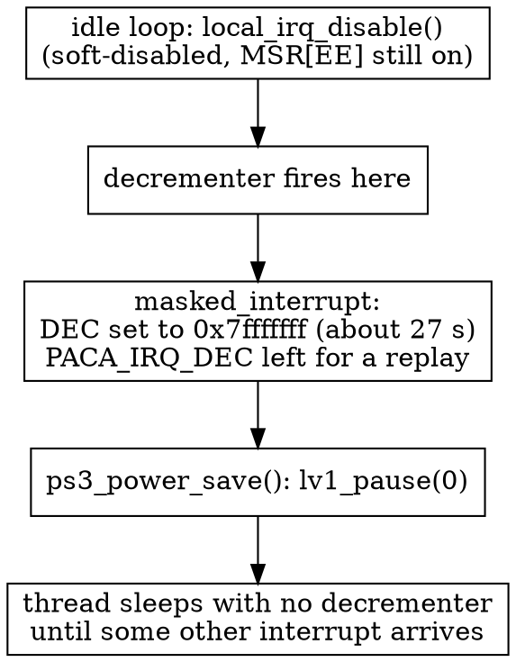

Once the kernel booted, I spent most of the following days on four kernel problems. One was a freeze of up to 1.4 seconds with the CPU idle. One was a shutdown path that, from reading the code, can hang. One was memory: the console has 256 MB and I wanted every megabyte. The last was the text consoles, which have to coexist with a GPU driver that wants the whole chip. Each one taught me something about this platform, so I'll go through them in that order.

## The 1.4 second stall

The symptom showed up in games. A game would play along and then freeze for a second or more, on a frame that had nothing special in it. I had built a stall recorder to catch these, and it taught me two odd things before it taught me anything useful.

First, the recorder removed stalls. The same boot, the same OpenArena build, the same Mesa and kernel, with the recorder off and on in turn:

| | off | on | off | on |
|---|---|---|---|---|
| gameplay stall time | 28.9 s | 7.1 s | 20.7 s | 7.3 s |
| steady fps | 53.0 | 61.3 | 54.4 | 61.4 |
| frames over 1 s in play | 6 | 0 | 3 | 0 |

A frame that did not stall cost the same either way: CPU time per frame was 18.9 ms with the recorder off and 18.5 ms with it on. So the game was not slower, it was waiting. The long waits were 3 to 4 seconds and landed on random frames, not on map loads, and swap was quiet during them.

Second, the recorder itself went late. It sleeps until an absolute 10 ms deadline at nice -10, and it still overslept by up to 879 ms. Its longest gaps began while the game's main thread was asleep in `dma_fence_default_wait`, waiting on the GPU, and ended with a frame of the same length. Two things that wait on a timer, the recorder's sleep and my GPU driver's fence poll, had both stopped and then both resumed together.

That pointed at timers. The driver signals fences from an hrtimer that fires every 250 µs while somebody waits, and an hrtimer fires on the CPU that started it. If that CPU stops getting timer interrupts, the fence is never signalled.

### An experiment with no game in it

To take the game and the driver out of the picture I wrote a small tool, `ps3-waker`, with a probe mode: a SCHED_FIFO thread pinned to each CPU thread that sleeps, over and over, and records how late it wakes up. On an otherwise idle console, the thread on the second hardware thread woke up to **1439 ms late**. Thirteen wakeups were 100 ms late or more, two of them over a second. The first thread's worst was 16.7 ms. When I added a "kicker" that sent an interrupt to each thread every 10 ms, the second thread's worst case fell to 19.4 ms.

That is not a game bug and not a driver bug. A timer on an idle CPU thread was not firing.

### The mechanism

I found the cause by reading `ps3_power_save()` in `arch/powerpc/platforms/ps3/setup.c`. It is the idle function. The generic idle loop calls it with interrupts soft-disabled but the hardware enable bit (MSR[EE]) still on, and it called `lv1_pause(0)` straight away. The other PowerPC idle routines call `prep_irq_for_idle()` first. The PS3 one did not.



The PowerPC decrementer is the per-thread timer interrupt. If it fires between `local_irq_disable()` and the hypercall, the kernel's masked-interrupt handler notes it for later, pushes the decrementer out to its maximum (about 27 seconds at the PS3's 79.8 MHz timebase) and returns. Normally the kernel replays that pending interrupt on the way out of the idle loop. But the PS3 code went on to pause the thread, and a paused thread with no decrementer pending sleeps until any other interrupt shows up.

Which interrupts reach which thread is the other half. `ps3_virq_setup()` binds every interrupt that can go to "any" CPU to thread 0: USB, the network card, the GPU's vsync, the SPEs. So thread 0 recovers within milliseconds. Thread 1 gets nothing except inter-processor interrupts, and it can stay asleep for seconds. The window is tiny, but a fence wait enters idle 4000 times a second, and the periodic 250 Hz tick has a chance of landing inside the window each time. The tick itself is that same decrementer, so it cannot rescue a thread that has lost it.

It also explains why the recorder helped. It wakes up 100 times a second, and when the scheduler placed a wakeup on the stuck thread (which looks idle), that cost an IPI, the thread woke up, replayed its decrementer, and the fence poll ran again.

### The fix

`local/0009` makes `ps3_power_save()` call `prep_irq_for_idle()` first, as pseries and the native Cell do. If something was masked since `local_irq_disable()`, it hard-disables and returns without pausing, and the replay runs. Otherwise it marks the thread soft-enabled, hard-enables, and pauses with MSR[EE] on, so that a decrementer or IPI from here on is a normal interrupt.

My first draft paused with MSR[EE] off, as powernv does. A review pass rejected it. It would rely on `lv1_pause()` ending when a decrementer is pending with interrupts off, and on the hypervisor leaving that exception pending for the guest. The only documentation I have is the comment "MSR[EE] has no effect". If either assumption were false, every idle thread would lose its tick. With MSR[EE] on, a small race remains between the hard-enable and the hypercall. An interrupt handled in that window that makes a task runnable is caught by the `need_resched()` check; any other ends at the next tick, at most 4 ms away. Not seconds.

There is an off switch for same-boot comparisons, a core parameter `ps3_idle_prep`, writable at run time.

### Results

Kernel 6.12.111+ps3.419, same boot, the probe test with no game, 120 seconds each:

| `ps3_idle_prep` | worst wakeup, thread 0 | worst wakeup, thread 1 |
|---|---|---|
| on | 3.6 ms | 4.0 ms |
| off | 16.7 ms | 1103 ms (11 wakeups of 100 ms or more) |

The fix beat the 10 ms kicker that I had been using as a workaround (19.4 ms worst case). In a game, a clean batch on a later kernel with the interference detector on (OpenArena, switch alternated, no kicker, no recorder) gave gameplay stalls of 0.4 and 0.4 s with the fix and 9.0 and 7.9 s without, and the longest frames were 0.22 to 0.38 s against 2.2 to 2.8 s.

Two caveats. If the fix had made the idle threads skip their pause every time, they would run hotter, and I never compared idle temperatures with it on and off. Kernels since keep the System Manager's temperatures in every benchmark run, so I can check when I want to. And I have not sent the patch upstream yet. A draft for linuxppc-dev is written and marked RFC. It still needs the with-fix numbers in its commit message and a rebase onto the powerpc tree.

## A shutdown that can hang

The second problem I found by reading. `ps3_sys_manager_fin()` in `drivers/ps3/ps3-sys-manager.c` sends the shutdown request to the System Manager and then loops with `while (ps3_sys_manager_handle_msg(dev))`: keep polling until a handler returns 0. The handler for the shutdown command returns 0 after it acknowledges the command. But the handler for events returns 0 as well, for every event.

So if a power-button press, a reset press or a thermal alert arrives between the request and the System Manager's reply, the loop ends early. The command is never read or acknowledged, the hypervisor never destroys the partition, and the console would sit at "System Halted, OK to turn off power" until somebody powers it off by hand.

I want to be careful here. I deduced this from the code. I have never seen the hang, and the window is small enough that I may not be able to provoke it. The upstream form of the patch is minimal: the command handler returns a distinct value (`PS3_SM_MSG_SHUTDOWN_ACKED`) once it has written the acknowledgement, and `fin()` waits for that value and nothing else. My local version does more (it resends the request up to three times, five seconds apart, and ignores button presses once the final shutdown has started) but that part is untested too, so I would not send it. The mainline file has the same loop as of 2026-10-18, when I checked.


Status for the user: both upstream drafts (idle, sys-manager) are written but not sent, and the sys-manager one is not tested on hardware beyond compiling. Decide whether the article should say "reported upstream" later or leave it as is.


## 8.7 MB of kernel

The kernel takes a big bite of a 256 MB machine. With the hypervisor's 16 MB gone, Linux starts with 240 MiB, and my first kernel's boot line said:

```text
Memory: 143960K/245760K available (6536K kernel code, 972K rwdata, 9848K rodata,
3244K init, 496K bss, 35012K reserved, 65536K cma-reserved)
```

35 MB reserved. I wanted to know where it went, so I wrote it down line by line, from the source files that do the reserving. The kernel image alone was 21,100 KB. Of that, 6,200 KB was **alignment padding between rodata and the init section**. Strict kernel memory protection (`STRICT_KERNEL_RWX`) on 64-bit PowerPC aligns the end of rodata to 16 MiB, and nothing frees the gap.

Then I measured each option the way I would measure a performance change. I built a separate `vmlinux` for every variant from the same source tree and compared section sizes. The control build, with the unchanged config, matched the shipped image section for section, which is how I know the deltas are real.

| Change | Resident image saved |
|---|---:|
| `STRICT_KERNEL_RWX=n` | 6,200 KB |
| `KALLSYMS_ALL=n` | 1,013 KB |
| IPv6, io_uring, quota, kexec, hugetlbfs off; NFSv4 as a module | 988 KB |
| `LOG_BUF_SHIFT` 17 to 16 | 288 KB (computed) |
| `DYNAMIC_DEBUG` and `IKCONFIG` off | 320 KB |
| smaller group: debug options, `SCHED_DEBUG` and the like | 130 KB |

Together that is the "release" flavour. The non-init part of the image goes from 17,856 KB to 8,964 KB, and on the console `MemTotal` rises from 213,992 kB to 222,716 kB, which is the 8.7 MB. (The `debug` flavour stays around for profiling, and Petitboot offers both.)

Two findings from this are worth passing on.

A module costs more RAM than its file size suggests, and more than a built-in. The loaded size of a module is 1.5 to 3 times its size on disk, because each one carries its symbol table, its string table and, on ELFv1 PowerPC, 48 bytes of call stub per distinct callee. A small one like `uhid` went from 7.8 KB to 20 KB loaded. So moving a driver from built-in to a module saves memory only if it stays unloaded in most sessions. A driver that is always loaded is cheaper built in.

And I kept `SLUB_DEBUG`. It costs 99 KB, but it gives `/proc/slabinfo`, which I use all the time for the memory work.

The release config also has a cost: no kallsyms for data, no `/proc/config.gz`, and no kexec. I am fine with all three on a machine whose only reboot path is through Petitboot anyway.

## Text consoles and the GPU

The last kernel item is the one a user would notice. The text console on the PS3 is `ps3fb`, a framebuffer driver that draws by sending commands to the RSX through a hypervisor interface. My GPU driver, `ps3rsx`, sends commands to the same chip. They cannot run at once, because they share the GPU's internal state. So they take turns, and I had to teach `ps3fb` about it.

The mechanism is a small API in `ps3fb`: `ps3fb_gpu_takeover(bool)` hands the GPU over, and the driver follows the display server through DRM's master calls. When X (or any master) is active, or when programs without X are submitting commands, `ps3rsx` owns the GPU. Otherwise `ps3fb` gets it back and draws the console.

- When you press Ctrl+Alt+F2, X loses its DRM master (`master_drop`). New submissions wait, except from a channel that is in the middle of a primitive, and once the GPU is idle `ps3fb` takes it and redraws the text console.
- When you switch back (`master_set`), `ps3rsx` takes the GPU, forgets what the chip's state held (the console changed it), makes the next command stream restore its whole state, and shows X's last frame.
- With no X at all, the first command takes the GPU and two seconds of idle give it back.

Two details in there took longer than they look. The locks: `own_lock` is outermost, then `console_lock`, then the GPU mutex. Lockdep found a cycle through the framebuffer's own lock very early, so takeover never takes that one. And the display: `ps3fb_blank` mutes the video output through the AV manager, which would blank a KMS screen, so while `ps3rsx` owns the GPU `ps3fb_blank` does nothing, and DPMS off uses a video mute that `ps3rsx` sends itself. The kernel command line carries `consoleblank=0` for the same reason.

The mute was also behind a bug: every X after the first started with a black screen. The driver cached whether the video was muted, and the cache was stale. The fix is that an unmute is always sent, and a re-flip on an active display unmutes it (`a1f1b91` and `8baa747`).


Photo suggestion: a text console on the TV (Ctrl+Alt+F2) next to the desktop. I did not find a screenshot in the docs. Also not verified: that Ctrl+Alt+Fn switching has been tested on the TV recently; the docs describe the mechanism and the commit log says it was added on 2026-10-14.


The next article is the big one: how a GPU that has no public documentation and runs under a hypervisor ended up running Mesa.
