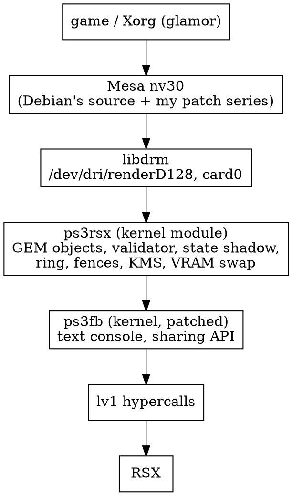
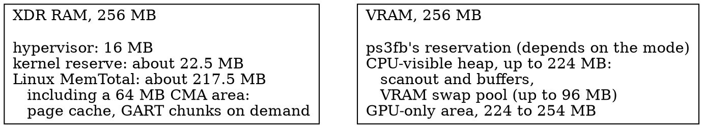

The PlayStation 3's GPU is called the RSX. It is an NVIDIA chip from the GeForce 7 family (NV47 class), and a GeForce 7600 GT is its cousin on a PCIe card. The prior work I found was a partial 2D X driver and an unfinished FreeBSD attempt, nothing that gave Mesa a 3D device to talk to. This article is about how I got OpenGL 2.1 running on it: a kernel driver, a patch series on Mesa's nv30 driver, and two memory tricks that the console's tiny RAM forced on me.

## The plan: reuse nouveau, replace the plumbing

The RSX speaks the same command language as a GeForce 7 on a PC, so Mesa's `nv30` Gallium driver, which handles the GeForce FX and 6/7 series, can in principle drive it. Nouveau's kernel side cannot be used as it is. It expects a PCI device it can map and an interrupt line of its own, while on a PS3 the GPU is reached through the hypervisor, with calls like `lv1_gpu_context_allocate`.

So the split was this. From nouveau I kept the ioctl interface, which Mesa already speaks, and the command format. I replaced device bring-up, memory management, interrupts and display with code that talks to lv1. The result is `ps3rsx`, a DRM driver that registers itself as "nouveau" version 1.3.1 (exactly the minimum Mesa wants), so stock libdrm and Mesa load it without knowing the difference.

## What the hypervisor gives you

Before writing any driver I had to learn what lv1 allows, and I did it with probes. A kernel module and a small userspace program (`rsx-probe`) let me poke at the GPU from Linux and write the results down. The probes are numbered E1 to E17, and I still cite them in commit messages. These are the findings that shaped the driver:

- **There is one VRAM allocation, and `ps3fb` owns it.** A second `lv1_gpu_memory_allocate` fails with error -17 for every argument set I tried. But a second *context* on `ps3fb`'s memory handle works, with its own FIFO, so a DRM driver can own a GPU channel next to the console.
- **The context limit is `ps3fb`'s plus two,** and allocating up to the limit and then freeing them stalls every FIFO, with no error (probe E1). I don't know which step breaks it. So the driver allocates one extra context once, keeps it forever, and never frees it.
- **The 3D state is shared between channels** (E5). A clear in context A, after context B had set its render target, went into B's target. lv1 does no context switching of the graphics engine's state. If two programs render at once, something has to restore the state of the first one when it gets the GPU back.
- **`GET` is not completion.** The FIFO's read pointer only says the command words were fetched. `SET_REFERENCE` is a real fence: its value appears in the control area only after the preceding rendering has landed in memory (E11).
- **The GPU reaches main memory through an IO window,** in 1 MB pages, at addresses below 256 MB. 64 KB pages fail.
- **The CPU is nearly useless against VRAM.** Writes with 8-byte stores run at 124 MB/s, glibc's `memcpy` at 19 MB/s, and reads at 10 MB/s. A DMA copy by the GPU's own copy engine (M2MF) moves 2.3 GB/s from VRAM to VRAM, 2.0 GB/s from RAM to VRAM and about 600 MB/s from VRAM to RAM.

That last list is the reason for most of the design. Everything the CPU wants from VRAM has to go through the GPU.

## Getting pixels out

On 2026-10-14 the project went through its first six phases, each with a stated finish line. A raw triangle and a textured quad, written as FIFO words by hand, drew on screen first. I photographed the monitor with a webcam to check, because HDMI capture is blocked by HDCP in the XMB. Then came the driver, then a Mesa clear, then Mesa rendering compared against `softpipe`, Mesa's software renderer.

That comparison was my correctness test. The rule I set was that the RSX's output had to be within one unit per colour channel of softpipe's. The offscreen `gears` test came out with 282 of 196,608 bytes one lower, nothing more. That is the hardware interpolating attributes slightly differently from a software renderer, not a bug I could chase. For the reference to match, softpipe had to use 24-bit depth like the console: with 16-bit depth, four pixels at silhouette edges resolved their depth tie the other way.

Phase 5 was kernel mode setting, where `kmscube` ran at 60 fps. Phase 6 was Xorg with the `modesetting` driver and glamor, which turns X's 2D drawing into OpenGL calls. `glxinfo` reported "NV47" with direct rendering, and `glxgears` ran at 60 fps. The log says the first six phases passed on 2026-10-14.


That date is what the git log and docs/DRIVER.md say. The project's first commit is also dated 2026-10-14, so the work before it (reading, probes) is not in the history. If you want a more careful sentence about how long this really took, it needs your own recollection.


## What Mesa needed

The Mesa side is a patch series on Debian's Mesa source (26.2.4 at the time of writing). Every change is gated on a PS3 check made early, in `nouveau_screen_init`: the chipset must be 0x47, the PCI vendor must be 0x104d, and a private `PS3_ABI` getparam that only `ps3rsx` answers must succeed. Anything unmodified, like Debian's own Mesa, fails cleanly at init instead of sending command streams the driver would reject.

The patches that mattered most, in the order I hit them:

- **Handles.** The hypervisor pre-creates the DMA contexts and objects under fixed handles (0xfeed0000 for VRAM, 0xfeed0001 for main memory, 0x31337000 for the 3D object). Mesa writes whichever handles it allocated, so substituting at allocation time makes the command stream carry the PS3 ones.
- **The fence value is byte-swapped.** The back-end semaphore release (0x1d70) stores its value with bytes 0 and 2 swapped. Mesa pre-swizzles the value so the readback matches (probe E4).
- **No 16-bit depth.** Z16 renders wrong next to a 32-bit colour buffer, so the PS3 only offers 24-bit.
- **A single inline vertex attribute draws nothing.** No exception, no fragments. That broke position-only draws such as glamor's fills. Two attributes work, so the lone one is pushed twice.
- **The RSX fetches big-endian vertex and index buffers itself.** Mesa's big-endian path pushed every vertex inline through the command stream. The RSX can fetch the data itself, and letting it do that took ClassiCube from 6.5 fps to a vsync-capped 60 at 1080p (79 uncapped, according to the patch notes).
- **Fragment programs are stored halfword-swapped** on this machine, and fragment colour is exported from fp32 registers, because the default fp16 export gave 2,193 bytes off in `gears` against 282 after the change.
- **A texture-bias lookup samples wrong.** The fragment program opcode TXB (`texture2D` with a bias argument) returns dark, flat values whatever the bias. I found it on 2026-10-20 in Warzone 2100, whose 3D shaders all use it. The same lookups were right as plain TEX. Mesa now emits TXB as TEX and drops the bias.

Not all of these crash the GPU; most just draw wrong. The ones that do crash it are the subject of the next article.

## Memory: the GART

The console has little RAM, and the GPU wants some of it. Whatever the GPU reads from main memory, vertex data, uploaded textures, the command buffer itself, goes through the IO window, which the driver calls the GART. The window works in 1 MB pages. That is awkward: after boot, finding a physically contiguous 1 MB block on a machine with 200 MB of RAM is unreliable.

My first approach was to reserve 32 MB at boot and keep it forever. I measured what the desktop and ClassiCube actually used (9 MB) and cut the reservation to 16 MB, but it was still memory the games could not have.

The second approach is what ships. A kernel patch declares a 64 MB CMA area, a region the kernel keeps for large contiguous allocations but lets ordinary movable pages occupy in the meantime. `ps3rsx` backs IO pages from it in 1 MB chunks, on demand, when a buffer first needs them, and gives a chunk back once it has been idle for 2 seconds and the GPU has passed every fence that could touch it. While a chunk is not in use, the kernel fills the CMA area with page cache. I tested it by filling the GART with 4 MiB buffers, with a GPU copy checked in each, with the CMA area full of movable pages and a 170 MB hog in swap: 56 MB were backed on demand, and the data was right. Measured games use 6.7 to 12.8 MB of it.

Every IO page without a chunk is mapped to one scratch chunk, since a stray GPU fetch that faulted would wedge the chip. (Probe E2 showed the window allows mapping one chunk at two addresses, which makes this cheap.)

## Memory: using VRAM as swap

The console has 256 MB of RAM and 256 MB of VRAM, and X plus a game use well under half of the VRAM. Linux gets 240 MiB of the RAM, and games push pages out of it. I decided to use the spare VRAM as swap space.

Three obvious places for swap were not available. The internal disk's regions belong to GameOS, and `mkswap` on any of them would destroy its data. An NFS swapfile deadlocked the console under memory pressure (a write error -12 on the direct-IO swapfile). zram, compressed swap in RAM, worked and was the first swap I used, but it spends RAM to save RAM.

The result is `ps3vswap0`, a block device in `ps3rsx`. It keeps each 4 KB swap page either in a VRAM slot or at the same position on a backing partition on the USB disk, so the swap layer sees a single device. Writes go to VRAM while there is room, in 1 MB chunks taken from the top of the CPU-visible heap, up to 96 MB by default. When a game needs VRAM for its own buffers, `ps3rsx_vswap_shrink()` writes the pages of the emptiest chunks back to disk and hands the chunks over. Games come first. In the background, the oldest chunk moves to disk when the pool is nearly full.

The reads were the hard part. Writing a page to VRAM with the CPU is fast enough, but reading one back at 10 MB/s would be a stall in every game. So swap-ins are copied by the GPU: `kcopy.c` submits an M2MF copy from VRAM into a pinned 1 MB GART bounce buffer, at roughly 600 MB/s, and the CPU reads from the bounce. It only does that when it can get the GPU without waiting. Every lock in that path is a trylock, and a failed trylock means "use the CPU". Since the GPU only ever reads the VRAM slots, a failed, late or wedged copy loses nothing: the CPU reads the same slot.

Block-layer code under memory pressure is hostile. Three bugs I fixed on the way:

- The shared two-entry bio reserve deadlocked on the bios a request holds until it drops its lock. The driver has its own reserve now, and caps its requests at 32 pages.
- That reserve needed `BIOSET_NEED_BVECS`. Without it every allocation from it returned NULL, and the first disk write oopsed in `kswapd`.
- blk-mq could run `queue_rq` inline from a plug flush deep in direct reclaim, where an interrupt then found under 4 KB of stack left. Requests run on the driver's own work queue with a fresh stack now.

The measurement: a working set that fits in the VRAM tier swaps in about 10 times faster, passes of 0.2 to 1.2 seconds against 4.4 to 17.7 s, with about 92,000 kernel copies interleaved with a GL test suite that passed three times in a row and no fallbacks. OpenArena itself did not improve, because by then its threads no longer blocked on swap-ins at all. Its remaining stalls were file reads from the USB disk.

## What it costs

There is no free lunch in a driver that checks everything. In the first profiles of the games, Mesa took 28 to 56% of a game's CPU time and `ps3rsx` 6 to 16%, against 4 to 11% for the game itself. Every game on the console is limited by the PPE, and the driver stack is most of what the PPE runs. Later rounds of Mesa patches (fewer words per draw, fewer fence reference operations, no relocations) bought 5 to 24% in most games, and the single biggest gains came from changing the games to make fewer GL calls. X-Moto went from 44.5 to 166.5 fps by batching, from 18,500 GL calls a frame down to 165.

Not tried yet: tiling, the GPU's depth-culling hardware, vertex texture fetch, and any kind of GPU reset that does not need the console to be power cycled.

That last one is the next article.
