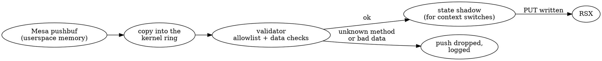

On a PC, when a GPU command goes wrong, you get a hang or a glitch, a driver resets the engine, and the desktop comes back. On the PS3's RSX, as far as I have been able to measure, one wrong command freezes the entire chip, and the only thing that brought it back was rebooting the console. For a machine that I can only reboot into Linux with the help of someone at the console, setting a flag in the XMB menu, that changes how a driver has to be written. This article is about the bad commands I found, in the order I found them, and about the checker I put in the kernel so that none of them can reach the GPU.

## What a graph exception is

The RSX's graphics engine (called PGRAPH on the NVIDIA chips it descends from) can reject a command in the middle of the stream. It raises a *graph exception* with a numeric cause and stops. In my kernel that shows up through `ps3fb`'s vsync interrupt handler, which prints it:

```text
ps3fb ioc0_01: ps3fb_vsync_interrupt: graphics exception
ps3fb ioc0_01: channel id 0x00000001 cause 0x00000106
ps3fb ioc0_01: fifo:
ps3fb ioc0_01: 	dma get 0x00002200 dma put 0x00003b34
ps3fb ioc0_01: 	get 0x00000053 put 0x00000042 ref 0x5ebd4649
```

Followed by the contents of the command cache in pairs, method address and data. `ps3rsx` hooks the same interrupt with a function that only records the event and schedules work (`ps3fb_gpu_set_exception_hook`), and adds a line naming the last process that submitted: `graph exception; last submit from channel -1, cube2_client (pid 675753)`. If an exception does not come, the driver has a second detector: no progress in the fence reference for 2 seconds while work is pending counts as a wedge too. Then it dumps the exception block, returns -EIO to the caller and errors every fence.

## It wedges everything

The first thing I tried, after an exception, was the obvious: reset the channel. Here is the list of things that did not bring the chip back, from the notes of the experiments in October:

- `ps3fb`'s own EXIT, which runs a FIFO setup and its reset program;
- freeing the context and allocating a new one;
- FIFO_PAUSE and FIFO_RESUME (both return 0);
- freeing every context and the memory handle, which unbinds `ps3fb` without crashing, and rebinding. The new handle and context allocate fine, but the first FIFO run times out.

After an exception on my driver's channel, `ps3fb`'s channel 0 stopped too. A freshly allocated context's FIFO did not fetch a single word. It is one GPU, not one channel. Only a console reboot recovered it. Whether a reboot of just the Linux partition through Petitboot would be enough is something I have not tested.

I can't tell you *why*. What I have is this: the graphics engine's state is shared across channels, because lv1 does no state switching (probe E5), and the failure survives every reset I can reach from a guest. Beyond that I don't know what the hypervisor keeps that I am not resetting. So the only workable rule is the one in the project notes: **the driver must never submit a command stream that faults.** Each experiment that wedged the chip cost a trip to the XMB, so risky GPU tests go last in a session.

## The causes I have found

These are all the causes I have seen, and how each turned up.

| Cause | Trigger | Found |
|---|---|---|
| 0x105 | An M2MF (the copy engine) transfer in a fresh context whose notifier DMA was never set | the early probes, October 2026 |
| 0x105 | A 3D texture sampled at an offset that is not 128-byte aligned. Mesa's blit read back a 2x2 mip level of a 32x32 two-channel texture at +0xaa0 | Neverball, 2026-10-17 |
| 0x106 | Rendering to a swizzled surface that is one pixel wide | Xorg crashes when windows were resized in a desktop session, 2026-10-14 |
| 0x106 | A draw from a vertex format of type 7 (unsigned 8-bit bytes, libgcm's "UB256") with three components | Sauerbraten, with a Mesa patch of mine, 2026-10-19 |
| 0x109 | M2MF methods sent to the 2D surface object | found while probing |
| exception, no cause recorded | Vertex format type 0 (a B8G8R8A8 format) | Phase 2, 2026-10-14 |

Two of these deserve a story.

**The one-pixel-wide render target.** X's glamor layer draws small things into small pixmaps, including some that are one pixel wide. When I resized windows in a desktop session, Xorg took a graph exception with cause 0x106. I collected three dumps (at desktop start, in Xorg, on a resize), and they pointed at a glamor draw into a very thin target. So I wrote a test program, `egl-thin`, that renders into targets of chosen sizes. A target 1 pixel wide and 64 high raised the exception. 2x64 did not. 64x1 did not. A linear 1427x1 target did not. The pattern is a *swizzled* render target (the GPU's tiled memory layout) with a log2 width of zero. Linear targets 1 pixel wide are fine. Mesa now keeps those targets linear on the PS3, and the validator refuses the format word that describes a swizzled one-pixel target. After the fix I ran the resize repro again in the desktop session and it held.

**The vertex format that I added myself.** On 2026-10-19 I tried a Mesa switch, `NV30_VTX_SNORM8`, to fetch Sauerbraten's R8G8B8 normals as 8-bit values. It sent them as type 7 with three components, and the RSX raised 0x106 2.2 seconds into the game's demo. The run before it, in the same boot and without the switch, had finished fine. The dump (my decoded version is below) shows `GET` pointing at a `BEGIN_END(TRIANGLES)`, a draw that did not start, so the exception came at the start of a draw and not at a method write. Among the last entries the graphics engine had taken are the vertex formats for the texture coordinates and the lightmap, but the slots after them, where a normal would be, are not in the printed part of the cache.

So I can't show you the offending word. What I did was argue from the outside. RPCS3, the PS3 emulator, runs commercial games and asserts that this vertex type has exactly 4 components. Nouveau's table for this chip family has the type only as a 4-component format. UB256 with one or two components was never seen in anything, so I count it as forbidden too. Only four components are safe. Mesa fetches four bytes now. This is an inference, not a proven fact, and I have it marked as such in the notes. A controlled re-test on the console is on my list.

## Reading a dump

The dump is awkward to read, and I only partly solved it. `ps3fb` prints 32 of the command cache's 512 entries, in groups of four at positions 0, 16, 32 and so on. They are not the entries around the one that faulted. Each pair is a method address and a data word, with the subchannel in bits 13 to 15 of the address and the method in `address & 0x1ffc`. `GET` and `PUT` are indexes into the cache. After the engine stops, the front end keeps filling the cache until `PUT` sits just behind `GET`, so in every dump I have, between 225 and 495 entries were pending. The entries from `PUT` to `GET - 1` are the last ones the engine took, in order. I decoded the UB256 one by hand:

```text
entries 0-3 (pending)    BEGIN_END TRIANGLES; VB_INDEX_BATCH 32 from 0x28bc; BEGIN_END STOP; TEX_SIZE1(0)
entries 66-67 (taken)    VTXFMT(1) 0x2022 (float x2, stride 32: texcoord); VTXFMT(2) 0x2025 (short x2: lightmap)
entries 80-82 (taken)    0x1718 0; IDXBUF_OFFSET 0x0e31c000; IDXBUF_FORMAT 0x10 (U16)
entry 83 (GET)           BEGIN_END TRIANGLES: the draw that did not start
```

The fix I want, and have not done, is for `ps3fb` to print the 32 entries ending at `GET`.

## The validator

If no fault can be allowed to reach the GPU, nothing the user's code writes can go straight to it. So the driver does not let Mesa's push buffer be read by the GPU directly. `GEM_PUSHBUF` copies each push into a 2 MB ring owned by the kernel, and the copy is what gets validated. Copying first avoids the classic check-then-modify race: what the validator sees is exactly what the GPU will run.



What `validate.c` checks:

- **Every method of every burst,** including non-incrementing headers. JMP, CALL and RETURN are refused outright, since they would let a stream leave the ring.
- **An allowlist of methods per object class.** Anything not on it is logged and rejected. The table has ranges expanded: 16 texture units at a stride of 0x20, 16 vertex formats and buffers, the vertex-program window, the constant window.
- **Object bindings** accept only the hypervisor's handles.
- **Data words at a few methods:** the DMA handle slots against a set of six known values, the location bits (1 or 2), and at the methods that trigger work (draw, clear, copy) the offset, pitch, clip and format against the bounds of the buffer object that owns them. A semaphore release must be 16-byte aligned and inside the channel's own fence slot. The vertex-program load pointer plus count must stay within 512 slots, constants within 468.
- **The specific combinations that wedge:** vertex format type 0, type 7 with any size but 4 (since `ps3rsx` 0.545~dev), swizzled render targets 1 pixel wide, and since 0.249 texture offsets that are not 128-byte aligned.

### Where the allowlist came from

I wrote it before anything of Mesa had run on the console. On 2026-10-14 I read every method that Mesa's nv30 driver can send to a chip with id 0x47 and compared it against two sources: RPCS3, which emulates what commercial games send, and libgcm, the SDK's graphics library, as far as RPCS3 documents it. The audit ranked the risks. The top one was object and DMA handles, which Mesa writes as its own values and the hardware wants as the hypervisor's. The second was init values that differ from libgcm's defaults, four of them. I worried that one of them could wedge the chip. I replayed Mesa's whole init stream on the console as a probe, and the GPU accepted all of it, including those four, and a clear worked afterwards. Of everything in the audit, one method (an M2MF no-op that RPCS3 doesn't know) was unknown to the emulator, and it turned out to be accepted. The vertex format type 0 was flagged as a moderate risk because it maps to RPCS3's "ub256" default. It was a real wedge.

The audit's per-class method list is the table the validator's allowlist is generated from.

### What a rejection costs

A rejection keeps that one push off the GPU, nothing more. But Mesa doesn't know it was dropped. Mesa keeps its own idea of what the GPU already holds (vertex formats it sent before, for one), and leaves out state it believes is current. After a dropped push, later draws in the channel can run on the GPU's older state, and a draw may fetch its vertices with a different draw's layout. Every word that did get through passed the validator, but the picture is no longer what the program meant. So a run that logs `ps3rsx: rejected push` is not a measurement, and I stop it. The validator is a seatbelt. It is not a way to test a known-bad stream.

An earlier version had a worse flaw. A rejected push in a multi-push submit left the earlier pushes' object bindings in the validator's state, and that was the route to a 0x109 wedge. It is fixed.

### What it costs in CPU

The checks run on every word of every game's command stream. In the first profiles they took 5 to 16% of a game's CPU time. Version 0.249 added a fast-path table with one lookup per word, which cuts the cost of inline data about 13 times in a host benchmark, and made the state shadow write per burst with dirty bitmaps, so a context switch restores only what changed (14.6 down to 1.3 µs on the host).

### What the validator does not cover

I want to be plain about this. The validator is as good as the knowledge behind it. The UB256 case wedged the chip on 2026-10-19 because I did not know the combination was dangerous, and the validator had no rule for it. The validator learned the rule afterwards. Today the vertex texture methods (0x900 to 0x97c) are still accepted without data checks. Everything on the allowlist is there because Mesa uses it and it has not wedged the chip yet, which is a weaker claim than "safe".


For the user: I did not find a statement in the docs of how many exceptions happened over the project in total, or how many console reboots they cost. If you remember, a sentence with the real count would help the opening. A photo of the black screen after a wedge would be good too.


## What I still want

A way to reset the chip without a reboot. The ideas are in the repository's backlog: a hardware context save area, finding out whether a reboot of just the Linux partition through Petitboot clears a wedge, and an interrupt for lv1's "user command" completion. None is tried. Until one works, the validator stays on by default, and the rule stays what it was: a faulting stream must never leave the kernel.
