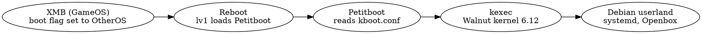


Alpha. The first public image and the install guide are not out yet. Everything below describes what runs on my own console today, not something you can download.


Walnut is a Debian-based Linux distribution for the PlayStation 3. It boots through Petitboot on a console that runs custom firmware with OtherOS++, it uses a current LTS kernel (6.12), and it drives the console's GPU, the RSX, with open-source code: a kernel driver I wrote (`ps3rsx`) and the nv30 driver from Mesa. The point is a PS3 that is not tied to Sony's software: a desktop, a package manager, and open-source games running at 1080p.

"PS3" and "PlayStation 3" only name the hardware on this site. Walnut has nothing to do with Sony, and it ships no Sony code, firmware or keys.

## The hardware

The machine I develop on is a first-generation slim (CECH-20xx) with an SSD in place of the stock hard disk. It is not much of a computer by today's standards, and every design decision in Walnut comes from that.

- **CPU:** one Cell Broadband Engine. The main core is the PPE, a 64-bit PowerPC core with two hardware threads, running big-endian. Next to it sit the SPEs, small vector cores with their own local memory. Linux gets six of them; a seventh can be switched on with a boot parameter, which I haven't tried yet.
- **Memory:** 256 MB of XDR RAM, of which the hypervisor keeps 16 MB. Linux sees 240 MiB, and a release kernel has about 217 MiB of it left after its own reserve. The GPU has another 256 MB of GDDR3.
- **GPU:** the RSX, an NVIDIA chip from the GeForce 7 family (NV47 class). OpenGL 2.1 and GLSL 1.20 at best, no usable video decode block.
- **Hypervisor:** Linux does not own the machine. It runs as a guest under Sony's hypervisor (lv1), asks it for everything through hypercalls, and gets what the OtherOS++ patches expose.

## How it boots

Petitboot is a small bootloader that runs a Linux kernel of its own, scans the disks and kexecs the one you pick. Every reboot from Walnut lands back in GameOS, and I set the flag again by hand each time. That is deliberate: GameOS stays the default operating system and the console is never left in a state I can't undo.

## What works today

All 13 games in my benchmark suite start and draw the right picture at 1920x1080 through Mesa nv30 and the `ps3rsx` driver. Six of them reach 60 fps or more with little stalling, and two more sit between 56 and 60. The rest are held back by the PPE or by memory. The numbers below are medians over a window of at least 120 seconds, taken after a 60 second warm-up.

| Game | Steady fps at 1080p | Notes |
|---|---|---|
| QuakeSpasm | 91.0 | |
| Yamagi Quake II | 68.7 | |
| X-Moto | 160.7 | |
| Armagetron Advanced | 83 | one run, live AI rounds |
| Neverball | 66.5 | |
| OpenArena (OpenGL 1 renderer) | 70.6 | |
| Extreme Tux Racer | 59 | |
| OpenArena (OpenGL 2 renderer) | 60.4 | 56 later in the same boot |
| dsda-doom (GL) | 55.9 | music chops when the synth runs on the SPEs |
| ClassiCube | 46 to 48 | GPU-bound |
| Luanti | 46 | memory stalls of 2 to 6 s in a 120 s window |
| Sauerbraten | 39.1 | 45.1 with short normals |
| SuperTuxKart | 20 to 22 | the lean settings |
| OpenTTD | 34 to 43 | with the 8bpp blitter; 11 with the default one on a large 1962 savegame |

The disk in my console is an SSD. A stock console has a 2.5" hard disk, and the load times in particular would be longer there. Several games (Quake, Quake II, ClassiCube) need data files I can't redistribute, so the first public image will not include them.


Check before publishing: whether the public image really drops QuakeSpasm, Yamagi Quake II and ClassiCube (docs/release/ALPHA.md M2 says the data-less ones go), and whether you want per-game links or the stalls columns from docs/games/README.md here.


Beyond games, the desktop is Openbox with a tint2 panel and PCManFM, and the memory is kept for the game: while a game runs, the rest of the desktop is frozen and its memory pushed out, then brought back afterwards. (Game mode's automatic start and its escape keys have not been seen on a TV yet.) The temperatures of the Cell and the RSX are readable under Linux, and the fan runs on the console's own automatic mode.

## The articles

These are the first four, about the hard parts. They are drafts.

1. [Making Linux boot on a modern kernel](/walnut/1-boot-on-a-modern-kernel/): OtherOS++, Petitboot, kexec, and the things that broke on the first day.
2. [Kernel work: the lost timer interrupt and a trimmed config](/walnut/2-kernel-work/): a 1.4 second stall that turned out to be a missing interrupt, a shutdown hang, 8.7 MB of RAM, and the text consoles.
3. [Getting the GPU going](/walnut/3-getting-the-gpu-going/): a DRM driver for a GPU nobody documented, Mesa on top, a GART that costs nothing while idle, and VRAM used as swap.
4. [Graph exceptions and the validator](/walnut/4-graph-exceptions-and-the-validator/): one wrong command freezes the RSX until the console is power cycled, so every command is checked first.
